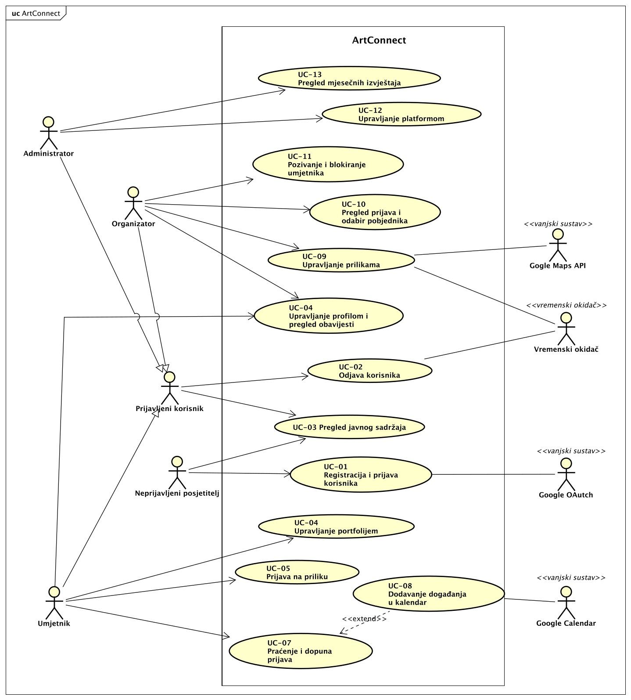
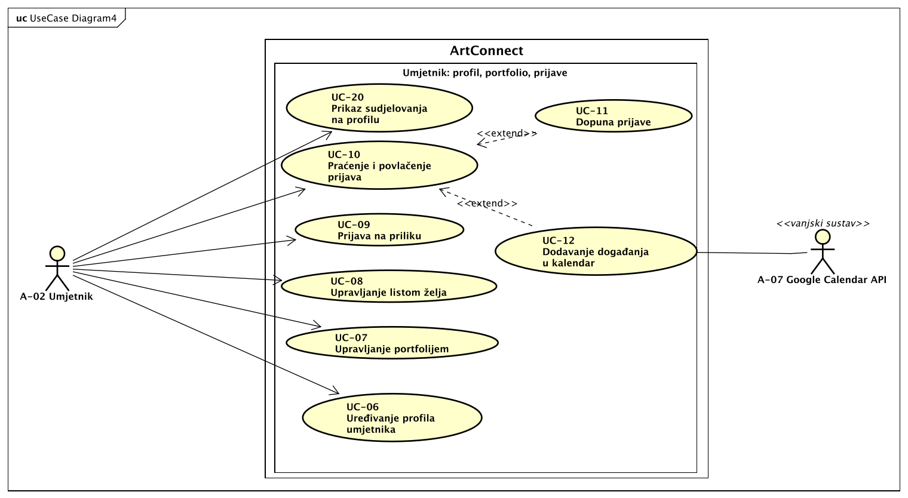
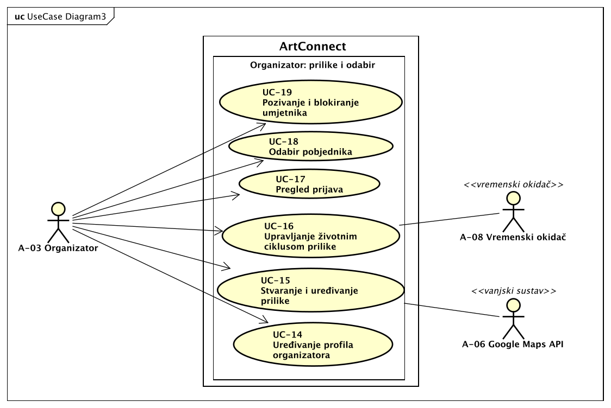
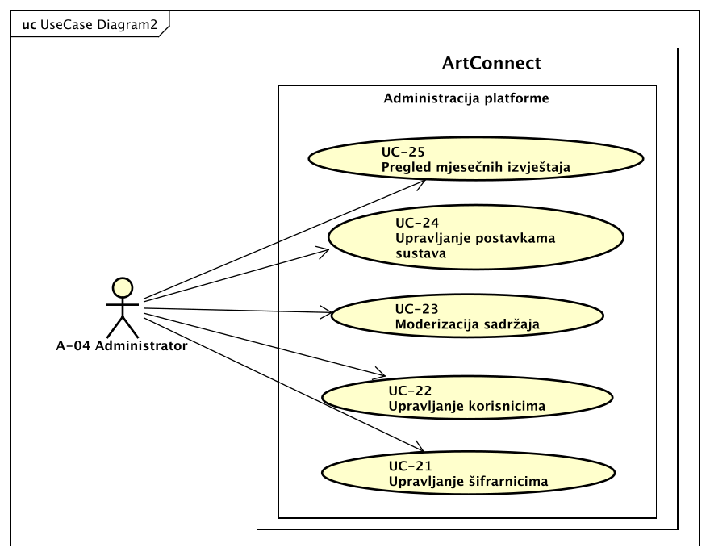
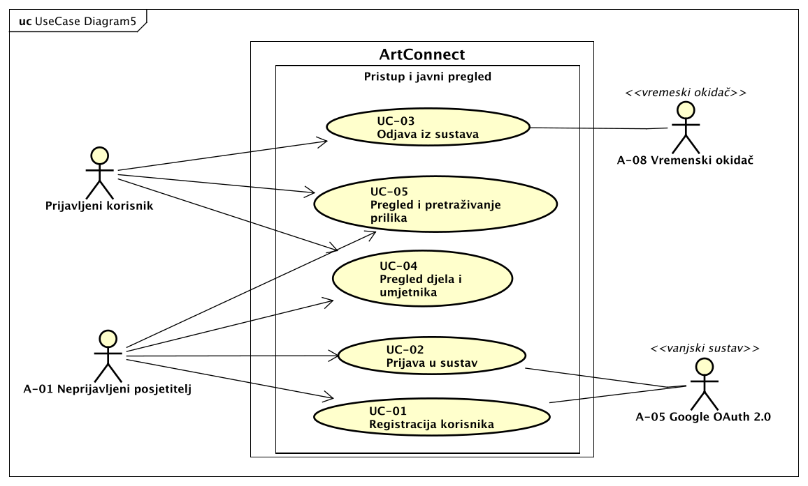

# 3. Obrasci uporabe

**Cilj:** Prikazati glavne interakcije između aktera aplikacije i sustava. Opišite kako akter ostvaruje cilj i što se događa kada važan korak ne uspije. Interakcije temeljite na odobrenim zahtjevima i ažurirajte ih kako se aplikacija razvija.

## 3.1 Dijagram obrazaca uporabe

**Cilj:** Prikazati granicu sustava, relevantne aktere i njihove glavne ciljeve u **preglednom UML dijagramu obrazaca uporabe**. Ako je za razumijevanje pojedinog dijela sustava potrebno prikazati više detalja, taj dio izdvojite u dodatni usmjereni dijagram. Dodatni dijagrami trebaju produbiti dio preglednog modela, a ne stvarati nepovezane ili duplicirane prikaze istog sustava.

**Slika 3.1. Dijagram obrazaca uporabe sustava ArtConnect**

**PlantUML izvor:** [izvor](./puml/3-1-artconnect-UC.puml)

**Opis dijagrama:** Granica sustava prikazuje svih 25 obrazaca uporabe grupiranih po područjima: pristup i javni pregled, umjetnik (profil, portfolio, prijave), obavijesti, organizator (prilike i odabir) te administracija platforme. Zbog širine dijagrama područja umjetnika, organizatora i administratora dodatno su prikazana u povećanom obliku u dijagramima 3.1.1 do 3.1.3, koji ne dodaju nove obrasce, nego samo preglednije prikazuju iste.

Primarni akteri su neprijavljeni posjetitelj (A-01), umjetnik (A-02), organizator (A-03) i administrator (A-04), kako su definirani u [odjeljku 2.3](./2-Analiza%20zahtjeva.md#23-dionici-i-akteri). Umjetnik, organizator i administrator generaliziraju apstraktnog aktera *Prijavljeni korisnik*, koji nosi ono što je zajedničko svim prijavljenim ulogama: odjavu (UC-03) te pregled javnih djela, umjetnika i prilika (UC-04, UC-05). Neprijavljeni posjetitelj obavlja registraciju i prijavu (UC-01, UC-02), a nakon prijave postaje korisnik u svojoj ulozi. Apstraktni akter služi samo za grupiranje zajedničkih ovlasti i nije nova uloga u sustavu, pa nema vlastiti ID u odjeljku 2.3.

Vanjski sustavi sudjeluju kao sekundarni akteri samo u obrascima u kojima izravno pomažu ostvariti korisnikov cilj: Google OAuth 2.0 (A-05) pri registraciji i prijavi, Google Maps API (A-06) pri unosu i prikazu lokacije prilike, Google Calendar API (A-07) pri dodavanju događanja u kalendar. Vremenski okidač (A-08) sudjeluje u automatskom zatvaranju prijava po isteku roka (UC-16) i u isteku sesije (UC-03).

**Zahtjev bez zasebnog aktera:** F-RL-3 (kontrola pristupa po ulozi) ne čini zaseban obrazac uporabe, nego vrijedi za sve obrasce prijavljenih korisnika. Ponašanje je opisano u alternativnim tokovima UC-02 i UC-03, a provodi se na poslužitelju (NF-04).

### 3.1.1 Detalj: obrasci uporabe umjetnika

**Slika 3.2. Detaljni dijagram obrazaca uporabe umjetnika**

**PlantUML izvor:** [izvor](./puml/3-1-artconnect-umjetnik-UC.puml)

Dijagram produbljuje područje portfolija i prijava: uređivanje profila, portfolio, lista želja, prijava na priliku, praćenje i povlačenje prijave, dopuna prijave, kalendar, obavijesti i prikaz sudjelovanja. Dopuna prijave (UC-11) prikazana je kao `<<extend>>` obrasca UC-10 jer se nudi samo kada organizator zatraži dopunu, odnosno kada prijava ima status „Potrebna dopuna”. Isto vrijedi za dodavanje događanja u kalendar (UC-12): proširuje UC-10 jer se nudi samo uz prijavu sa statusom „Prihvaćena”, a status se dodjeljuje tek završetkom odabira (UC-18), dakle nakon što je tok predaje prijave (UC-09) završen. Google Calendar API (A-07) sekundarni je akter u UC-12. Drugi `<<include>>` i `<<extend>>` odnosi nisu prikazani jer ne odgovaraju stvarnom ponašanju sustava.

### 3.1.2 Detalj: obrasci uporabe organizatora

**Slika 3.3. Detaljni dijagram obrazaca uporabe organizatora**

**PlantUML izvor:** [izvor](./puml/3-1-artconnect-organizator-UC.puml)

Dijagram produbljuje upravljanje prilikama: profil organizatora, stvaranje i uređivanje prilike s provjerom adrese preko Google Maps API-ja (A-06), životni ciklus prilike s automatskim zatvaranjem prijava koje pokreće Vremenski okidač (A-08), pregled prijava, odabir pobjednika, pozivanje i blokiranje umjetnika te obavijesti.

### 3.1.3 Detalj: obrasci uporabe administratora

**Slika 3.4. Detaljni dijagram obrazaca uporabe administratora**

**PlantUML izvor:** [izvor](./puml/3-1-artconnect-administrator-UC.puml)

Dijagram prikazuje administraciju platforme: šifrarnike, korisnike, moderaciju sadržaja, postavke sustava i mjesečne izvještaje.

### 3.1.4 Detalj: obrasci uporabe pristupa i javnog pregleda

**Slika 3.5. Detaljni dijagram obrazaca uporabe pristupa i javnog pregleda**

**PlantUML izvor:** [izvor](./puml/3-1-artconnect-pristup-UC.puml)

Dijagram prikazuje obrasce uporabe povezane s pristupom sustavu i javnim pregledom: registraciju korisnika (UC-01), prijavu u sustav (UC-02), odjavu iz sustava (UC-03), pregled djela i umjetnika (UC-04) te pregled i pretraživanje prilika (UC-05). Neprijavljeni posjetitelj (A-01) može se registrirati ili prijaviti te pregledavati javna djela, umjetnike i prilike. Prijavljeni korisnik može se odjaviti i koristiti javne preglede. Google OAuth 2.0 (A-05) sudjeluje u registraciji i prijavi, dok Vremenski okidač (A-08) pokreće istek sesije i time povezanu odjavu. Dijagram je detaljniji prikaz područja „Pristup i javni pregled” iz preglednog dijagrama i ne uvodi nove obrasce uporabe.

## 3.2 Specifikacije obrazaca uporabe

**Cilj:** Za svaki obrazac uporabe iz dijagrama objasniti cilj aktera, uobičajenu interakciju s aplikacijom i važne alternative. Jednostavne obrasce uporabe opišite kratko; proširite one kod kojih alternative, vanjske ovisnosti ili posljedice zahtijevaju dodatno objašnjenje.

**Za svaki obrazac uporabe koristite jednu okomitu tablicu.** Navedite samo onoliko pojedinosti koliko interakcija zahtijeva; neprimjenjivu alternativu izostavite umjesto da je popunjavate samo radi forme.

### 3.2.1 Pristup usluzi

### UC-01: Registracija korisnika

| Element specifikacije | Opis |
| :--- | :--- |
| **Primarni akter** | Neprijavljeni posjetitelj (A-01); sekundarni akter: Google OAuth 2.0 (A-05) |
| **Povezani zahtjevi** | F-RL-1 |
| **Preduvjeti** | Posjetitelj nije prijavljen i ima Google račun. |
| **Glavni uspješni tok** | 1. Posjetitelj odabire registraciju i željenu ulogu (umjetnik ili organizator). 2. Aplikacija ga preusmjerava na Google radi autorizacije. 3. Posjetitelj potvrđuje svoj Google račun. 4. Aplikacija prikazuje obrazac za osnovne podatke: umjetnik unosi ime, jedno ili više područja djelovanja iz popisa aktivnih područja i, neobavezno, poveznice na vlastite stranice; organizator unosi ime, prezime i naziv organizacije. 5. Posjetitelj šalje obrazac; aplikacija provjerava podatke, stvara račun i prijavljuje korisnika na Dashboard odabrane uloge. |
| **Alternativni tokovi / Iznimke** | **3a — Odbijena autorizacija na Googleu:** Račun se ne stvara, aplikacija prikazuje poruku o grešci i vraća posjetitelja na početnu stranicu. **4a — Google račun već ima odabranu ulogu:** Aplikacija objašnjava da je registracija u toj ulozi već obavljena i nudi prijavu (UC-02). Isti Google račun može se registrirati i u drugoj ulozi, pa korisnik može biti i umjetnik i organizator. **5a — Nedostaju obavezni podaci ili su neispravni:** Aplikacija uz polje objašnjava problem (npr. nije odabrano nijedno područje djelovanja) i ne stvara račun; posjetitelj ispravlja podatke i ponavlja korak 5. |
| **Posljedice (ishod)** | Stvoren je račun u odabranoj ulozi, a korisnik je prijavljen. Sustav ne pohranjuje lozinke (NF-05). |

### UC-02: Prijava u sustav

| Element specifikacije | Opis |
| :--- | :--- |
| **Primarni akter** | Registrirani korisnik koji nije prijavljen (umjetnik A-02, organizator A-03 ili administrator A-04, do prijave u ulozi A-01); sekundarni akter: Google OAuth 2.0 (A-05) |
| **Povezani zahtjevi** | F-RL-1 |
| **Preduvjeti** | Korisnik nije prijavljen. Račun postoji u sustavu; administratorski računi unaprijed su definirani i ne stvaraju se registracijom. |
| **Glavni uspješni tok** | 1. Korisnik odabire ulogu i „Prijava putem Googlea”. 2. Aplikacija ga preusmjerava na Google. 3. Korisnik potvrđuje svoj Google račun. 4. Aplikacija provjerava da račun postoji u odabranoj ulozi i da nije blokiran, uspostavlja sesiju i preusmjerava korisnika na Dashboard njegove uloge. |
| **Alternativni tokovi / Iznimke** | **1a — Pristup Dashboardu bez prijave (F-RL-3):** Neprijavljeni korisnik koji otvori stranicu Dashboarda preusmjerava se na prijavu u sustav. **3a — Odbijena autorizacija na Googleu:** Prijava ne uspijeva, aplikacija prikazuje poruku o grešci i korisnik ostaje neprijavljen. **4a — Google račun nije registriran:** Aplikacija preusmjerava korisnika na registraciju (UC-01). **4b — Račun je blokiran:** Aplikacija odbija prijavu i prikazuje odgovarajuću poruku. |
| **Posljedice (ishod)** | Uspostavljena je sesija. Korisnik ima pristup samo Dashboardu svoje uloge; Dashboard druge uloge odbija se statusom 403 (NF-04). |

### UC-03: Odjava iz sustava

| Element specifikacije | Opis |
| :--- | :--- |
| **Primarni akter** | Prijavljeni korisnik (apstraktni akter: umjetnik A-02, organizator A-03 ili administrator A-04); sekundarni akter: Vremenski okidač (A-08) |
| **Povezani zahtjevi** | F-RL-2 |
| **Preduvjeti** | Korisnik je prijavljen. |
| **Glavni uspješni tok** | 1. Korisnik klikne gumb „Odjava”. 2. Aplikacija poništava sesiju. 3. Aplikacija preusmjerava korisnika na početnu stranicu. |
| **Alternativni tokovi / Iznimke** | **1a — Istek sesije:** Vremenski okidač poništava sesiju po isteku njezina trajanja (određenog postavkama sustava, UC-24). Pri sljedećoj radnji korisnik se preusmjerava na prijavu uz poruku da je sesija istekla. Aktivnost korisnika produljuje sesiju. **3a — Povratak na Dashboard nakon odjave (F-RL-3):** Korisnik pokuša gumbom „Natrag” otvoriti Dashboard; aplikacija odbija pristup i preusmjerava ga na prijavu. |
| **Posljedice (ishod)** | Sesija je poništena i stranice Dashboarda više nisu dostupne bez nove prijave. |

### 3.2.2 Javni pregled

### UC-04: Pregled djela i umjetnika

| Element specifikacije | Opis |
| :--- | :--- |
| **Primarni akter** | Neprijavljeni posjetitelj (A-01) ili prijavljeni korisnik |
| **Povezani zahtjevi** | F-NU-1 |
| **Preduvjeti** | Nema. |
| **Glavni uspješni tok** | 1. Posjetitelj otvara javni pregled djela ili umjetnika. 2. Aplikacija prikazuje javna djela, odnosno umjetnike. 3. Posjetitelj pretražuje djela po nazivu ili umjetnike po imenu i području umjetnosti. 4. Posjetitelj otvara djelo ili javni profil umjetnika; aplikacija prikazuje javna djela, biografiju i sudjelovanja umjetnika. |
| **Alternativni tokovi / Iznimke** | **3a — Nema rezultata:** Aplikacija prikazuje poruku da ništa nije pronađeno. **4a — Djelo nije javno:** Privatno djelo ne prikazuje se ni u pregledu, ni u pretrazi, ni preko izravne poveznice (NF-03). |
| **Posljedice (ishod)** | Nema promjene podataka. |

### UC-05: Pregled i pretraživanje prilika

| Element specifikacije | Opis |
| :--- | :--- |
| **Primarni akter** | Neprijavljeni posjetitelj (A-01) ili prijavljeni korisnik |
| **Povezani zahtjevi** | F-NU-2, F-NU-3 |
| **Preduvjeti** | Nema. |
| **Glavni uspješni tok** | 1. Posjetitelj otvara pregled prilika; aplikacija prikazuje aktivne prilike. 2. Posjetitelj pretražuje prilike i filtrira ih po području, lokaciji, roku i statusu. 3. Posjetitelj otvara priliku; aplikacija prikazuje njezine podatke, rok i datum događanja. 4. Posjetitelj odabire prikaz završenih prilika; aplikacija ih prikazuje odvojeno od aktivnih, a na stranici završene prilike i popis pobjednika. |
| **Alternativni tokovi / Iznimke** | **2a — Nema rezultata:** Aplikacija prikazuje poruku da nijedna prilika nije pronađena. **3a — Prijava neprijavljenog posjetitelja:** Posjetitelj se ne može prijaviti na priliku; pokušaj prijave preusmjerava ga na prijavu u sustav (UC-02). |
| **Posljedice (ishod)** | Nema promjene podataka. Prilike u pripremi nisu vidljive. |

### 3.2.3 Umjetnik: profil, portfolio i prijave

### UC-06: Uređivanje profila umjetnika

| Element specifikacije | Opis |
| :--- | :--- |
| **Primarni akter** | Umjetnik (A-02) |
| **Povezani zahtjevi** | F-UP-1, F-OB-2 |
| **Preduvjeti** | Umjetnik je prijavljen. |
| **Glavni uspješni tok** | 1. Umjetnik otvara postavke profila; aplikacija prikazuje trenutne podatke: ime, područja djelovanja, poveznice, biografiju i opis rada te postavke obavijesti. 2. Umjetnik mijenja podatke i, po želji, uključuje ili isključuje pojedine vrste obavijesti. 3. Umjetnik sprema izmjene. 4. Aplikacija provjerava podatke, sprema ih i prikazuje potvrdu. |
| **Alternativni tokovi / Iznimke** | **3a — Neispravni podaci:** Podatak nije valjan (npr. prazno ime, nijedno područje djelovanja, neispravna poveznica); aplikacija uz polje objašnjava problem i ništa ne sprema, a umjetnik ispravlja podatke i ponavlja korak 3. **3b — Odustajanje:** Umjetnik napušta uređivanje i profil ostaje nepromijenjen. |
| **Posljedice (ishod)** | Izmjene su vidljive na javnom profilu. Umjetnik više ne prima vrste obavijesti koje je isključio. |

### UC-07: Upravljanje portfolijem

| Element specifikacije | Opis |
| :--- | :--- |
| **Primarni akter** | Umjetnik (A-02) |
| **Povezani zahtjevi** | F-UP-2, F-UP-3 |
| **Preduvjeti** | Umjetnik je prijavljen. |
| **Glavni uspješni tok** | 1. Umjetnik otvara svoj portfolio; aplikacija prikazuje sva njegova djela, javna i privatna, s oznakom vidljivosti. 2. Umjetnik dodaje novo djelo: unosi osnovne podatke (naziv, godinu nastanka, tehniku, dimenzije, opis) i prilaže datoteke. 3. Aplikacija provjerava obavezna polja te format i veličinu datoteka i sprema djelo kao privatno. 4. Umjetnik po želji uređuje djelo, mijenja njegovu vidljivost (javno ili privatno) i pregledava ga kao javni korisnik. 5. Umjetnik po želji briše djelo uz potvrdu; aplikacija ga uklanja iz portfolija i s javnog profila. |
| **Alternativni tokovi / Iznimke** | **3a — Nevaljana datoteka:** Format nije JPG, PNG ili PDF ili datoteka prelazi 10 MB (NF-02); aplikacija je odbija uz razumljivu poruku i djelo se ne sprema dok se datoteka ne ispravi ili ukloni. **3b — Nedostaju obavezni podaci:** Nedostaju naziv ili barem jedna datoteka ili je godina nastanka u budućnosti; aplikacija objašnjava problem i ne sprema djelo. **5a — Djelo je dio aktivne prijave:** Djelo koje je priloženo prijavi u statusu „Predana”, „U pregledu” ili „Potrebna dopuna” ne može se obrisati; aplikacija prikazuje poruku s nazivom prilike. **5b — Brisanje nije potvrđeno:** Djelo ostaje nepromijenjeno. |
| **Posljedice (ishod)** | Portfolio odražava dodane, izmijenjene ili obrisane radove. Privatno djelo nije javno vidljivo, uključujući izravne poveznice na datoteke (NF-03). |

### UC-08: Upravljanje listom želja

| Element specifikacije | Opis |
| :--- | :--- |
| **Primarni akter** | Umjetnik (A-02) |
| **Povezani zahtjevi** | F-UW-1 |
| **Preduvjeti** | Umjetnik je prijavljen; prilika je otvorena za prijave. |
| **Glavni uspješni tok** | 1. Umjetnik na kartici ili stranici prilike odabire „Dodaj na listu želja”. 2. Aplikacija sprema priliku na listu želja. 3. Umjetnik kasnije otvara listu želja; aplikacija prikazuje spremljene prilike po roku za prijavu, od najbližeg. 4. Kad pripremi sve što treba, umjetnik se s liste izravno prijavljuje na priliku (UC-09). |
| **Alternativni tokovi / Iznimke** | **1a — Ponovni odabir:** Ako je prilika već na listi, ponovni odabir uklanja je s liste. **3a — Prijave su zatvorene:** Prilika ostaje na listi s oznakom da su prijave zatvorene, bez mogućnosti prijave. **3b — Prazna lista:** Aplikacija prikazuje odgovarajuću poruku. |
| **Posljedice (ishod)** | Lista želja odražava umjetnikov odabir. Nakon uspješne prijave prilika se automatski uklanja s liste. |

### UC-09: Prijava na priliku

| Element specifikacije | Opis |
| :--- | :--- |
| **Primarni akter** | Umjetnik (A-02) |
| **Povezani zahtjevi** | F-PP-1 |
| **Preduvjeti** | Umjetnik je prijavljen i ima barem jedno djelo u portfoliju. Prilika je u statusu „Otvoreno za prijave”, rok nije istekao, organizator nije blokirao umjetnika i umjetnik se još nije prijavio na tu priliku. |
| **Glavni uspješni tok** | 1. Umjetnik na stranici prilike, njezinoj kartici ili listi želja odabire „Prijavi se”. 2. Aplikacija prikazuje obrazac prijave s djelima iz umjetnikova portfolija (javnim i privatnim). 3. Umjetnik odabire djela te, po želji, upisuje poruku organizatoru i prilaže privitke. 4. Umjetnik šalje prijavu. 5. Poslužitelj provjerava rok, status prilike, blokadu, postojeću prijavu i privitke te sprema prijavu sa statusom „Predana”. 6. Aplikacija prikazuje potvrdu, gumb prelazi u „Prijavljeno”, a organizator prima obavijest. |
| **Alternativni tokovi / Iznimke** | **1a — Umjetnik je blokiran:** Umjesto gumba „Prijavi se” aplikacija prikazuje poruku da prijava na ovu priliku nije moguća. **1b — Već prijavljen:** Gumb „Prijavljeno” je onemogućen; izravan pokušaj ponovne prijave poslužitelj odbija. **4a — Nije odabrano nijedno djelo:** Aplikacija objašnjava da je potrebno barem jedno djelo i ne sprema prijavu. **4b — Nevaljan privitak:** Format ili veličina ne zadovoljavaju NF-02; privitak se odbija uz poruku, a prijava se ne šalje dok se ne ispravi. **5a — Rok je istekao ili prilika nije otvorena:** Poslužitelj odbija prijavu, uključujući izravan API poziv (NF-01); baza ostaje nepromijenjena, a umjetnik dobiva poruku. **5b — Spremanje nije uspjelo:** Aplikacija prijavljuje grešku i ne prikazuje lažnu potvrdu. |
| **Posljedice (ishod)** | Pohranjena je prijava sa statusom „Predana”. Organizator je obaviješten, a prilika se uklanja s umjetnikove liste želja. |

### UC-10: Praćenje i povlačenje prijave

| Element specifikacije | Opis |
| :--- | :--- |
| **Primarni akter** | Umjetnik (A-02) |
| **Povezani zahtjevi** | F-PP-2, F-PP-3 |
| **Preduvjeti** | Umjetnik je prijavljen i ima barem jednu prijavu. |
| **Glavni uspješni tok** | 1. Umjetnik otvara „Moje prijave”; aplikacija prikazuje njegove prijave sa statusom (predana, u pregledu, potrebna dopuna, prihvaćena, odbijena), a prijave na završene prilike u povijesti. 2. Umjetnik otvara prijavu i pregledava njezine podatke. 3. Umjetnik odabire „Povuci prijavu” i potvrđuje. 4. Aplikacija trajno briše prijavu zajedno s privicima i uklanja je s popisa. |
| **Alternativni tokovi / Iznimke** | **2a — Prijava je odbijena:** Uz prijavu aplikacija prikazuje razlog odbijanja koji je unio organizator. **2b — Potrebna dopuna:** Aplikacija prikazuje poruku organizatora i nudi dopunu prijave (UC-11). **3a — Prijave su zatvorene:** Povlačenje nije dostupno, a izravan API zahtjev poslužitelj odbija. **3b — Povlačenje nije potvrđeno:** Prijava ostaje nepromijenjena. |
| **Posljedice (ishod)** | Povučena prijava više nije vidljiva organizatoru i ne ulazi u statistike ni izvještaje; umjetnik se na priliku može ponovno prijaviti dok su prijave otvorene. Dok odabir traje, umjetnik ne vidi je li njegova prijava označena. |

### UC-11: Dopuna prijave

| Element specifikacije | Opis |
| :--- | :--- |
| **Primarni akter** | Umjetnik (A-02) |
| **Povezani zahtjevi** | F-PP-3, F-ON-4 |
| **Preduvjeti** | Organizator je zatražio dopunu (UC-17), pa prijava ima status „Potrebna dopuna”. Prilika nije u statusu „Završeno”. |
| **Glavni uspješni tok** | 1. Umjetnik otvara prijavu i čita poruku organizatora. 2. Umjetnik odabire „Dopuni prijavu”. 3. Umjetnik dodaje tražene materijale (djela ili privitke) i, po želji, poruku. 4. Umjetnik šalje dopunu. 5. Aplikacija provjerava materijale, sprema dopunu, vraća prijavu u status „U pregledu” i obavještava organizatora. |
| **Alternativni tokovi / Iznimke** | **3a — Nevaljan privitak:** Format ili veličina ne zadovoljavaju NF-02; aplikacija odbija privitak uz poruku i dopuna se ne šalje. **5a — Prilika je u međuvremenu završena:** Aplikacija odbija dopunu uz objašnjenje i prijava ostaje nepromijenjena. |
| **Posljedice (ishod)** | Prijava ima status „U pregledu” i sadrži dodane materijale. Dopuna je moguća i nakon isteka roka za prijavu. |

### UC-12: Dodavanje događanja u kalendar

| Element specifikacije | Opis |
| :--- | :--- |
| **Primarni akter** | Umjetnik (A-02); sekundarni akter: Google Calendar API (A-07) |
| **Povezani zahtjevi** | F-PP-4 |
| **Preduvjeti** | Umjetnik je prijavljen, a njegova prijava ima status „Prihvaćena”. Obrazac proširuje UC-10 (`<<extend>>`): nudi se iz popisa prijava samo uz prihvaćenu prijavu. |
| **Glavni uspješni tok** | 1. Umjetnik uz prihvaćenu prijavu odabire „Dodaj u kalendar”. 2. Aplikacija traži od umjetnika autorizaciju pristupa njegovom Google kalendaru. 3. Umjetnik odobrava pristup. 4. Google Calendar stvara događaj s nazivom prilike, datumom i vremenom događanja te adresom, ako je unesena. Ako završetak nije unesen, događaj traje jedan sat. 5. Aplikacija prikazuje potvrdu. |
| **Alternativni tokovi / Iznimke** | **3a — Odbijena autorizacija:** Aplikacija prikazuje poruku o grešci, događaj se ne stvara, a prijava ostaje nepromijenjena. **4a — Google Calendar ne odgovara:** Ako API ne odgovori unutar 5 sekundi, aplikacija umjesto upisa nudi preuzimanje događaja kao `.ics` datoteke (NF-07). |
| **Posljedice (ishod)** | Događaj je upisan u umjetnikov kalendar (ili je preuzet kao `.ics`). Podaci prijave ne mijenjaju se. |

### UC-20: Prikaz sudjelovanja na profilu

| Element specifikacije | Opis |
| :--- | :--- |
| **Primarni akter** | Umjetnik (A-02) |
| **Povezani zahtjevi** | F-PP-5 |
| **Preduvjeti** | Umjetnikova prijava je prihvaćena, a prilika je završena (UC-18). |
| **Glavni uspješni tok** | 1. Po završetku odabira aplikacija automatski dodaje sudjelovanje u odjeljak „Sudjelovanja” na javnom profilu pobjednika. 2. Umjetnik otvara svoj profil i pregledava sudjelovanja. 3. Umjetnik odabire sakrivanje sudjelovanja ili njegovo isticanje na vrhu profila. 4. Aplikacija sprema odabir i ažurira javni profil. |
| **Alternativni tokovi / Iznimke** | **3a — Poništavanje:** Ponovni odabir isticanja uklanja isticanje, a sakriveno sudjelovanje umjetnik može ponovno prikazati. |
| **Posljedice (ishod)** | Javni profil prikazuje sudjelovanja prema umjetnikovu odabiru: sakrivena nisu vidljiva, a istaknuta su na vrhu. |

### 3.2.4 Obavijesti

### UC-13: Pregled obavijesti

| Element specifikacije | Opis |
| :--- | :--- |
| **Primarni akter** | Umjetnik (A-02) ili organizator (A-03) |
| **Povezani zahtjevi** | F-OB-1 |
| **Preduvjeti** | Korisnik je prijavljen. |
| **Glavni uspješni tok** | 1. Korisnik otvara Inbox; aplikacija prikazuje broj nepročitanih obavijesti. 2. Aplikacija prikazuje popis obavijesti od najnovije (npr. prijave, dopune, pozivi). 3. Korisnik klikom otvara obavijest, a aplikacija je označava pročitanom i ažurira broj nepročitanih. |
| **Alternativni tokovi / Iznimke** | **2a — Nema obavijesti:** Aplikacija prikazuje prazan Inbox s odgovarajućom porukom. |
| **Posljedice (ishod)** | Otvorene obavijesti označene su pročitanima. Obavijesti vrsta koje je korisnik isključio (UC-06, UC-14) ne prikazuju se. Obavijesti se šalju samo unutar aplikacije. |

### 3.2.5 Organizator: prilike i odabir

### UC-14: Uređivanje profila organizatora

| Element specifikacije | Opis |
| :--- | :--- |
| **Primarni akter** | Organizator (A-03) |
| **Povezani zahtjevi** | F-OS-1, F-OB-2 |
| **Preduvjeti** | Organizator je prijavljen. |
| **Glavni uspješni tok** | 1. Organizator otvara postavke; aplikacija prikazuje ime, prezime, naziv organizacije i postavke obavijesti. 2. Organizator mijenja podatke i, po želji, uključuje ili isključuje pojedine vrste obavijesti. 3. Organizator sprema izmjene. 4. Aplikacija provjerava i sprema podatke te prikazuje potvrdu. |
| **Alternativni tokovi / Iznimke** | **3a — Nedostaje obavezan podatak:** Ime, prezime ili naziv organizacije je prazan; aplikacija uz polje objašnjava problem i ništa ne sprema. **3b — Odustajanje:** Podaci ostaju nepromijenjeni. |
| **Posljedice (ishod)** | Izmjene su vidljive na javnom profilu organizatora. Organizator više ne prima vrste obavijesti koje je isključio. |

### UC-15: Stvaranje i uređivanje prilike

| Element specifikacije | Opis |
| :--- | :--- |
| **Primarni akter** | Organizator (A-03); sekundarni akter: Google Maps API (A-06) |
| **Povezani zahtjevi** | F-ON-1, F-ON-2 |
| **Preduvjeti** | Organizator je prijavljen. Za uređivanje i brisanje: prilika pripada tom organizatoru. |
| **Glavni uspješni tok** | 1. Organizator odabire „Nova prilika” (ili „Uredi” na vlastitoj prilici). 2. Organizator unosi obavezne podatke (naslov, vrstu prilike, područje umjetnosti, rok za prijavu, početak događanja te opis), a po želji kraj događanja, adresu i privitke. 3. Organizator sprema priliku. 4. Aplikacija provjerava obavezna polja i datume, a Google Maps provjerava adresu. 5. Aplikacija sprema priliku; nova prilika dobiva status „Priprema”. Opis se prikazuje oblikovano, a ugrađeni HTML i skripte se ne izvršavaju. Ako je unesena adresa, lokacija se prikazuje na karti. |
| **Alternativni tokovi / Iznimke** | **4a — Nedostaju obavezna polja ili su datumi neispravni:** Rok je u prošlosti, početak događanja je prije roka ili kraj prije početka; aplikacija objašnjava problem i ne sprema priliku. **4b — Adresa nije prepoznata:** Aplikacija prikazuje poruku i ne sprema priliku dok se adresa ne ispravi ili ukloni. **4c — Nevaljan privitak:** Format ili veličina ne zadovoljavaju NF-02; privitak se odbija uz poruku. **5a — Karta nedostupna:** Ako Google Maps ne odgovori unutar 5 sekundi, lokacija se prikazuje kao tekstualna adresa, a ostale radnje nastavljaju raditi (NF-07). **2a — Skraćivanje roka:** Nakon objave rok se može samo produžiti; skraćivanje aplikacija odbija. **2b — Brisanje prilike:** Organizator briše vlastitu priliku uz potvrdu; ako prilika ima prijave, brisanje je onemogućeno uz objašnjenje. Tuđu priliku organizator ne može vidjeti, urediti ni obrisati (NF-04). |
| **Posljedice (ishod)** | Prilika je spremljena (ili izmijenjena, odnosno obrisana). Nova prilika nije javno vidljiva dok je u pripremi; objavljuje se u UC-16. |

### UC-16: Upravljanje životnim ciklusom prilike

| Element specifikacije | Opis |
| :--- | :--- |
| **Primarni akter** | Organizator (A-03); sekundarni akter: Vremenski okidač (A-08) |
| **Povezani zahtjevi** | F-ON-3 |
| **Preduvjeti** | Organizator je prijavljen i prilika je njegova. |
| **Glavni uspješni tok** | 1. Organizator u statusu „Priprema” odabire „Objavi priliku” i potvrđuje. 2. Aplikacija provjerava da je rok u budućnosti i mijenja status u „Otvoreno za prijave”; prilika postaje javno vidljiva, a umjetnici se mogu prijaviti. 3. Po potrebi organizator prije roka odabire „Zatvori priliku” (status „Prijave zatvorene”) ili je ponovno otvara odabirom „Otvori priliku”, ako rok nije istekao. 4. Kada su prijave prikupljene, organizator odabire „Započni odabir” i potvrđuje; status prelazi u „U procesu odabira”. Odabir pobjednika nastavlja se u UC-18. |
| **Alternativni tokovi / Iznimke** | **1a — Rok je istekao:** Objava se odbija uz poruku da treba pomaknuti rok. **2a — Istek roka:** Vremenski okidač po isteku roka automatski mijenja status iz „Otvoreno za prijave” u „Prijave zatvorene”. **3a — Ponovno otvaranje nakon isteka roka:** Nije moguće dok organizator ne produlji rok (UC-15). **3b — Nedopuštena promjena statusa:** Vraćanje u „Priprema” te ponovno otvaranje nakon pokretanja odabira nisu moguća; aplikacija ih odbija. **4a — Radnja nije potvrđena:** Status prilike ostaje nepromijenjen. |
| **Posljedice (ishod)** | Prilika je u novom statusu. Dok su prijave zatvorene, umjetnici se ne mogu ni prijaviti ni povući prijavu. Poslužitelj prihvaća prijave samo za prilike u statusu „Otvoreno za prijave” (NF-01). |

### UC-17: Pregled prijava

| Element specifikacije | Opis |
| :--- | :--- |
| **Primarni akter** | Organizator (A-03) |
| **Povezani zahtjevi** | F-ON-4, F-ON-6 |
| **Preduvjeti** | Organizator je prijavljen i prilika je njegova. |
| **Glavni uspješni tok** | 1. Organizator otvara svoju priliku; aplikacija prikazuje popis prijava (ime umjetnika, datum predaje, status) i ukupan broj prijava. 2. Organizator otvara prijavu; aplikacija prikazuje odabrana djela, poruku i privitke, a status „Predana” pri prvom otvaranju prelazi u „U pregledu”. 3. Po potrebi organizator odabire „Zatraži dopunu” i upisuje obaveznu poruku. 4. Aplikacija mijenja status prijave u „Potrebna dopuna” i obavještava umjetnika. 5. Organizator po želji pregledava osnovne statistike svojih prilika: broj prijava po području i prilici te broj pobjednika. |
| **Alternativni tokovi / Iznimke** | **1a — Nema prijava:** Aplikacija prikazuje odgovarajuću poruku. **3a — Poruka nije upisana:** Aplikacija ne šalje zahtjev za dopunom dok se poruka ne upiše. **3b — Prilika je u odabiru ili završena:** Zahtjev za dopunom nije dostupan. |
| **Posljedice (ishod)** | Statusi pregledanih prijava su ažurirani, a umjetnik je obaviješten o zahtjevu za dopunom. Povučene prijave ne prikazuju se i ne broje. Statistike sadrže samo zbirne vrijednosti, bez osobnih podataka umjetnika (NF-06). |

### UC-18: Odabir pobjednika

| Element specifikacije | Opis |
| :--- | :--- |
| **Primarni akter** | Organizator (A-03) |
| **Povezani zahtjevi** | F-ON-5 |
| **Preduvjeti** | Organizator je prijavljen, prilika je njegova i u statusu „U procesu odabira” (UC-16). |
| **Glavni uspješni tok** | 1. Organizator otvara popis prijava na priliku. 2. Organizator označava pobjednike, a za sve ostale prijave upisuje razlog odbijanja. 3. Organizator odabire „Završi odabir”. 4. Aplikacija prikazuje potvrdu s brojem pobjednika i brojem odbijenih prijava. 5. Organizator potvrđuje; aplikacija označene prijave postavlja u „Prihvaćena”, ostale u „Odbijena” s upisanim razlogom i prilike u „Završeno”. 6. Aplikacija objavljuje rezultate te obavještava sve prijavljene umjetnike. |
| **Alternativni tokovi / Iznimke** | **2a — Označavanje je privremeno:** Organizator može mijenjati oznake proizvoljno često; umjetnici ih ne vide, a statusi prijava se ne mijenjaju do završetka odabira. **3a — Neoznačena prijava bez razloga:** Završetak odabira je onemogućen uz prikaz broja prijava bez razloga odbijanja. **4a — Nijedna prijava nije označena:** Aplikacija upozorava da prilika neće imati pobjednika; organizator potvrđuje ili odustaje. **5a — Završetak nije potvrđen:** Statusi prijava i prilike ostaju nepromijenjeni. |
| **Posljedice (ishod)** | Prilika je „Završeno”, a statusi prijava su konačni i više se ne mogu mijenjati. Rezultati su javno objavljeni, a sudjelovanja pobjednika dodana su na njihove profile (UC-20). |

### UC-19: Pozivanje i blokiranje umjetnika

| Element specifikacije | Opis |
| :--- | :--- |
| **Primarni akter** | Organizator (A-03) |
| **Povezani zahtjevi** | F-OU-1 |
| **Preduvjeti** | Organizator je prijavljen i gleda javni profil umjetnika. |
| **Glavni uspješni tok** | 1. Organizator na profilu umjetnika odabire „Pozovi”. 2. Aplikacija nudi organizatorove prilike otvorene za prijave. 3. Organizator odabire priliku. 4. Aplikacija šalje umjetniku obavijest s poveznicom na priliku. 5. Po potrebi organizator odabire „Blokiraj” i potvrđuje; blokirani umjetnik više se ne može prijaviti na prilike tog organizatora. Organizator ga kasnije može odblokirati. |
| **Alternativni tokovi / Iznimke** | **2a — Nema otvorenih prilika:** Aplikacija objašnjava da nema prilike na koju bi se umjetnik mogao pozvati. **3a — Poziv nije moguć:** Umjetnik je već pozvan na tu priliku, već se prijavio ili je blokiran; aplikacija objašnjava razlog i ne šalje poziv. **5a — Blokiranje nije potvrđeno:** Stanje ostaje nepromijenjeno. |
| **Posljedice (ishod)** | Pozvani umjetnik ima obavijest o pozivu. Blokirani umjetnik umjesto gumba „Prijavi se” vidi poruku da prijava nije moguća, dok već predane prijave ostaju nepromijenjene. |

### 3.2.6 Administracija platforme

### UC-21: Upravljanje šifrarnicima

| Element specifikacije | Opis |
| :--- | :--- |
| **Primarni akter** | Administrator (A-04) |
| **Povezani zahtjevi** | F-AD-1 |
| **Preduvjeti** | Administrator je prijavljen. |
| **Glavni uspješni tok** | 1. Administrator otvara popis područja umjetnosti ili vrsta prilika. 2. Administrator dodaje novi zapis, preimenuje postojeći ili ga deaktivira. 3. Aplikacija provjerava podatke, sprema promjenu i prikazuje ažurirani popis. |
| **Alternativni tokovi / Iznimke** | **3a — Naziv je prazan ili već postoji:** Aplikacija objašnjava problem i ne sprema promjenu. **2a — Deaktivacija zapisa u uporabi:** Deaktivacija je dopuštena; zapis ostaje uz postojeće profile i prilike, ali se više ne nudi za nove unose. Brisanje zapisa nije moguće. |
| **Posljedice (ishod)** | Aktivna područja i vrste nude se pri registraciji, uređivanju profila, stvaranju prilike i u filtrima pretrage. |

### UC-22: Upravljanje korisnicima

| Element specifikacije | Opis |
| :--- | :--- |
| **Primarni akter** | Administrator (A-04) |
| **Povezani zahtjevi** | F-AD-2 |
| **Preduvjeti** | Administrator je prijavljen. |
| **Glavni uspješni tok** | 1. Administrator otvara popis korisnika (uloga, datum registracije, status računa) i po potrebi ga pretražuje. 2. Administrator ovjerava organizatora ili poništava ovjeru; ovjeren organizator ima oznaku pored imena. 3. Administrator blokira korisnika ili briše njegov račun i potvrđuje radnju. 4. Aplikacija provodi promjenu i prikazuje ažurirani status. |
| **Alternativni tokovi / Iznimke** | **3a — Vlastiti račun:** Administrator pokušava blokirati ili obrisati vlastiti račun; aplikacija to odbija. **3b — Radnja nije potvrđena:** Račun ostaje nepromijenjen. |
| **Posljedice (ishod)** | Blokirani korisnik ne može se prijaviti (UC-02), a njegov javni sadržaj nije vidljiv. Oznaka ovjere prikazuje se, odnosno uklanja, na profilu i prilikama organizatora. |

### UC-23: Moderacija sadržaja

| Element specifikacije | Opis |
| :--- | :--- |
| **Primarni akter** | Administrator (A-04) |
| **Povezani zahtjevi** | F-AD-2 |
| **Preduvjeti** | Administrator je prijavljen. Sadržaj je objavljen bez prethodnog odobravanja pa se uklanja naknadno. |
| **Glavni uspješni tok** | 1. Administrator pronalazi neprimjereno djelo ili priliku. 2. Administrator odabire uklanjanje i upisuje razlog. 3. Administrator potvrđuje radnju. 4. Aplikacija uklanja sadržaj iz javnog prikaza i pretrage te vlasniku prikazuje da je sadržaj uklonjen, uz razlog. |
| **Alternativni tokovi / Iznimke** | **2a — Razlog nije upisan:** Aplikacija ne uklanja sadržaj dok se razlog ne unese. **4a — Uklanjanje prilike s prijavama:** Brišu se i sve prijave na tu priliku, a prijavljeni umjetnici primaju obavijest s razlogom. **3a — Radnja nije potvrđena:** Sadržaj ostaje nepromijenjen. |
| **Posljedice (ishod)** | Uklonjeni sadržaj više nije vidljiv javnosti ni u rezultatima pretrage. |

### UC-24: Upravljanje postavkama sustava

| Element specifikacije | Opis |
| :--- | :--- |
| **Primarni akter** | Administrator (A-04) |
| **Povezani zahtjevi** | F-AD-1 |
| **Preduvjeti** | Administrator je prijavljen. |
| **Glavni uspješni tok** | 1. Administrator otvara osnovne postavke sustava (npr. ograničenja datoteka i trajanje sesije po ulozi). 2. Administrator mijenja vrijednosti i sprema ih. 3. Aplikacija provjerava vrijednosti i sprema ih. |
| **Alternativni tokovi / Iznimke** | **3a — Neispravna vrijednost:** Npr. negativan broj ili nula; aplikacija je odbija uz poruku i zadržava prethodnu vrijednost. |
| **Posljedice (ishod)** | Nove vrijednosti primjenjuju se na sve nove unose i sesije bez ponovnog pokretanja sustava. |

### UC-25: Pregled mjesečnih izvještaja

| Element specifikacije | Opis |
| :--- | :--- |
| **Primarni akter** | Administrator (A-04) |
| **Povezani zahtjevi** | F-AD-3 |
| **Preduvjeti** | Administrator je prijavljen. |
| **Glavni uspješni tok** | 1. Administrator odabire mjesec. 2. Aplikacija prikazuje broj registriranih umjetnika, objavljenih prilika i predanih prijava za taj mjesec. 3. Administrator preuzima izvještaj u CSV formatu. |
| **Alternativni tokovi / Iznimke** | **2a — Mjesec bez aktivnosti:** Aplikacija prikazuje nulte vrijednosti. |
| **Posljedice (ishod)** | Izvještaj sadrži samo zbirne vrijednosti, bez osobnih podataka pojedinih umjetnika (NF-06). Podaci se ne mijenjaju. |

---

## 3.3 Provjera dosljednosti obrazaca uporabe

**Cilj:** Provjeriti međusobnu usklađenost obrazaca uporabe, aktera, zahtjeva i ispitnih slučajeva. Cjelovito mapiranje održava se isključivo u **[matrici sljedivosti zahtjeva](2-Analiza%20zahtjeva.md#26-sljedivost-zahtjeva)**.

| Provjera | Pitanje za tim |
| --- | --- |
| Zahtjev | Je li svaki važan obrazac uporabe povezan s postojećim zahtjevom? |
| Akter | Odgovara li akter naveden ovdje prethodno utvrđenoj ulozi i dopuštenoj interakciji? |
| Aplikacija | Može li tim demonstrirati opisani glavni rezultat i važnu alternativu ili je opis jasno označen kao trenutačno oblikovanje? |

---

Povezivanje zahtjev → obrazac uporabe → ispitivanje održavajte **samo jednom, u [tablici sljedivosti zahtjeva](./2-Analiza%20zahtjeva.md#26-sljedivost-zahtjeva)**. Ovdje nemojte održavati drugu projektnu tablicu mapiranja ni stupac sa statusom implementacije. Ako važan zahtjev nema interakciju s ljudskim akterom, objasnite gdje se obrađuje umjesto izmišljanja aktera. U ovom dokumentu to vrijedi za F-RL-3 (kontrola pristupa, odjeljak 3.1) te za automatsko zatvaranje prijava i istek sesije, koje pokreće Vremenski okidač (A-08, UC-03 i UC-16).

**Završna provjera:** Dijagram, specifikacije obrazaca uporabe i matrica sljedivosti međusobno su usklađeni. Svaki važan obrazac uporabe povezan je s postojećim zahtjevom, akteri odgovaraju stvarnim ulogama u aplikaciji, a opisani glavni i alternativni tokovi odgovaraju ponašanju koje sustav stvarno podržava.
