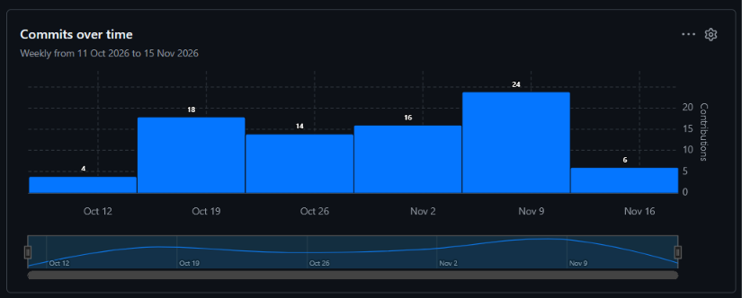

# A. Pregled aktivnosti grupe

## A.1 Evidencija sastanaka

Kratice članova tima: 
- MB = Mia Barada
- VC = Vilim Crčić, 
- MC = Matko Crnoja, 
- AD = Ana Dumbović, 
- BJ = Borna Janežić, 
- LK = Luka Kauzlarić, 
- LS = Leon Sabljak																												

| Datum i sudionici | Glavna tema | Donesena odluka ili zadatak  | Poveznica na zadatak ili  rezultat, ako postoji |
| --- | --- | --- | --- |
| 19.10.2026.; MB, VC,  MC, AD, BJ, LK, LS | Dogovor i organizacija rada za prvi ciklus|  Tim se odlučio prvo na izradu autentifikacije pa portofolija. Donesena je podjela: VC i BJ rade backend, MC i LS bazu, MB i AD frontend te LK dokumentaciju.|                                             |
| 3.11.2026.; MB, VC,  MC, AD, BJ, LK, LS | Usklađivanje frontenda i backenda te ostvarivanje registracije korisnika |  Odlučeno je da se pri registraciji na formi provjerava samo jesu li ispunjeni ime i prezime; ti se podaci ne povlače iz Google računa|  |   
| 10. 11. 2026.; BJ, VC, LS, MC | Upoznavanje sa sučeljem za programski (Python) pristup S3 bucketu | BJ, VC, LS su uspješno podesili .env file i povezali se sa S3 bucketom za upload datoteka; Dogovorili smo se za daljnji rad oko backenda |  |                                        

## A.2 Plan rada
[ArtConnect Roadmap](https://github.com/users/matkocrnoja/projects/2)

## A.3 Aktivnosti i doprinosi članova

| Aktivnost ili rezultat | Član | Prijavljeni sati | Reprezentativni rezultat ili poveznica |
| --- | --- | --- | --- |
|  Podešavanje početne strukture projekta i početne ER sheme| MC | 1.5h |  |
|  Uspostava AWS servera i SQL baze podataka| MC | 2h |  |
|  Izrada projektne specifikacije | MC | 1h | [1-Projekt.md](/docs/1-Projekt.md) |
|  Specifikacija zahtjeva | BJ, MC, LK | 4.5h | [2-Analiza-zahtjeva.md](/docs/2-Analiza%20zahtjeva.md) |
|  Izrada sučelja za prijavu i registraciju | AD & MB | 2h |  |
|  Izrada kostura FastAPI-backenda | BJ & VC | 1+1h |  |
|  Izrada backenda za prijavu i registraciju | BJ & VC | 8+10h |  |
|  Izrada navigacijskog okna za Dashboard | AD & MB | 2h |  |
|  Ažuriranje, održavanje ER dijagrama i usklađivanje SQL-a u production bazi | LS | (kontinuirano, on call) |  |
|  Specifikacija ER dijagrama u dokumentaciji | LS | 2.5h | [4-Arhitektura-i-oblikovanje/4.3.1](/docs/4-Arhitektura-i-oblikovanje.md#431-er-dijagram-i-model-podataka) |
|  Izrada funkcionalnosti: Postavke (korisnika) | LS | 6h | |
|  Izrada sučelja: Moj-portfolio | AD | 5.5h | |
|  Izrada sučelja: Moje-prilike | MB | 5.5h+ (još nije gotovo) | |
|  Postavljanje S3 bucketa i test-bencha | MC | 2.5h | |
|  Izrada backenda za upload medija t.d. se podržava funkcionalnost portfolija i prilika | BJ & VC | 4+2h | |
|  Izrada obrazaca uporabe | LK | 4.5h | [3-Obrasci-uporabe.md](/docs/3-Obrasci-uporabe.md) |
|  Izrada reprezentativnog UML dijagram razreda | LK | 2.5h | [4-Arhitektura-i-oblikovanje](/docs/4-Arhitektura-i-oblikovanje.md) |

## A.4 Pregled promjena u repozitoriju

Pregled promjena najbolje je vidjeti na [ovoj stranici](https://github.com/matkocrnoja/ArtConnect/issues?q=is%3Aissue+state%3Aclosed), sortirajući od najstarijih do najnovijih zadataka.

Zadatci (kronološki):
- [Sažimanje količine funkcionalnih zahtjeva](https://github.com/matkocrnoja/ArtConnect/issues/1)
- [Izrada komponente za registraciju](https://github.com/matkocrnoja/ArtConnect/issues/2)
- [Registracija koristeći OAuth2.0 (Google)](https://github.com/matkocrnoja/ArtConnect/issues/3)
- [Dashboard prijavljenog umjetnika](https://github.com/matkocrnoja/ArtConnect/issues/4)
- [Izrada i održavanje ER dijagrama](https://github.com/matkocrnoja/ArtConnect/issues/5)
- [Izrada dokumentacije: Obrasci uporabe](https://github.com/matkocrnoja/ArtConnect/issues/6)
- [Usklađivanje frontenda i backenda (registracija, prijava)](https://github.com/matkocrnoja/ArtConnect/pull/7)
- [Postavke umjetnika/organizatora](https://github.com/matkocrnoja/ArtConnect/issues/8)
- [Umjetnik: Moj portfolio - frontend](https://github.com/matkocrnoja/ArtConnect/issues/9)
- [Umjetnik: Moj portfolio - backend](https://github.com/matkocrnoja/ArtConnect/issues/11)

U zaključnom komentaru ili listi aktivnosti svakog zadatka nalazi se
- Pripadajuća lista commitova koji su zaslužni za ostvarenje zadataka ili
- Poveznica na pull request u kojem je zadatak zatvoren

## A.5 Ključni inženjerski izazovi i rješenja

| Izazov | Poduzeta radnja | Ishod ili preostalo ograničenje |
| --- | --- | --- |
| Spajanje poslužitelja na S3 bucket za datoteke djela. | Na sastanku 10. 11. BJ, VC i LS postavili su `.env` datoteku i povezali se s bucketom; MC je napravio testnu skriptu, a VC upload i kontrolu pristupa datotekama. | Upload radi; S3 je izborna konfiguracija pa poslužitelj bez nje odgovara statusom 503. |
| Na Windowsu `mimetypes` ne vraća nastavak za `image/webp`, pa su ključevi u S3 bucketu ostajali bez nastavka. | U `s3storage.py` dodan je zaobilazni put koji vrstu `image/webp` rastavlja i uzima zadnji dio. | Datoteke tog formata dobivaju nastavak `webp` na svim platformama. |
| Zahtjevi su bili preopširni za pregled. | LK i MC spojili su srodne zahtjeve i skratili kriterije (1. 11., vidi odjeljak 2.5). | Zahtjevi u dokumentu 2 sažeti su na 28 funkcijskih. |
| Spajanjem grana u korijenski direktorij repozitorija dospio je cijeli `node_modules` (141 datoteka, ~60 000 redaka) zajedno s `package.json` izvan frontend projekta. | MC je poništio spajanje (`dee4988`) i uklonio `package.json` i `package-lock.json` iz korijena (`63b8b90`), tako da se ovisnosti instaliraju samo unutar `vite-frontend/`. | U repozitoriju više nema praćenih datoteka iz `node_modules`. Ograničenje: `node_modules` je ignoriran samo u `vite-frontend/.gitignore`; korijen repozitorija nema vlastiti `.gitignore`. |
| Instalacija backend ovisnosti nije uspijevala na Windows računalima članova tima jer biblioteka `uvloop` ne podržava Windows. | MC je ovisnost označio uvjetno: `uvloop==0.23.0; sys_platform != "win32"` (`f54a0b9`). | `pip install -r requirements.txt` radi na Windowsima i na Linux poslužitelju; na Windowsima se koristi zadana asyncio petlja. |
| Frontend je imao fiksnu adresu API-ja, a lokalni razvoj (Vite + uvicorn na :8000) i produkcija (nginx) zahtijevaju različite adrese. | MC je u `vite-frontend/src/api/client.ts` uveo odabir adrese prema okruženju (`8eb2ecb`): `http://localhost:8000` u razvoju, `/api` u produkciji, gdje nginx prosljeđuje zahtjeve uvicornu. | Isti kod radi lokalno i na poslužitelju bez ručnih izmjena prije postavljanja. |
| Ime i prezime povlačili su se iz Google računa, a ti podaci nisu uvijek odgovarali stvarnom imenu korisnika ili su nedostajali. | Na sastanku 3. 11. 2026. odlučeno je da korisnik ime i prezime unosi sam; VC je uklonio preuzimanje tih podataka od Googlea i dodao provjeru na backendu i frontendu (`f55fd07`). LS je kasnije dodao pravilo "samo slova i razmaci” (`74d207c`) te NFC normalizaciju i ograničenja duljine (`fbdee25`). | Ime se provjerava jednako na klijentu i poslužitelju, a baza dodatno ograničava duljinu polja. |
| U ER modelu i bazi strani ključ između umjetnika i portfolija bio je postavljen u krivom smjeru. | LS je ispravio relaciju u bazi, dodao ograničenja duljine imena i naziva organizacije te ažurirao ER dijagram (`fbdee25`). | Shema baze i ER dijagram u [4.3.1](/docs/4-Arhitektura-i-oblikovanje.md#431-er-dijagram-i-model-podataka) su usklađeni. |

---
